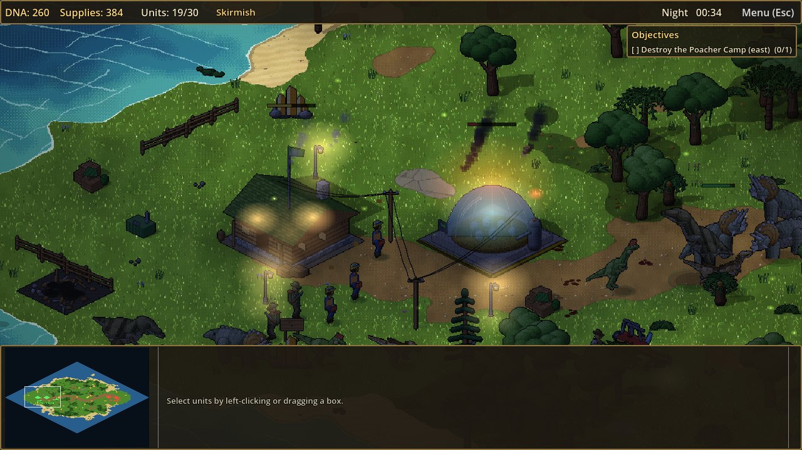
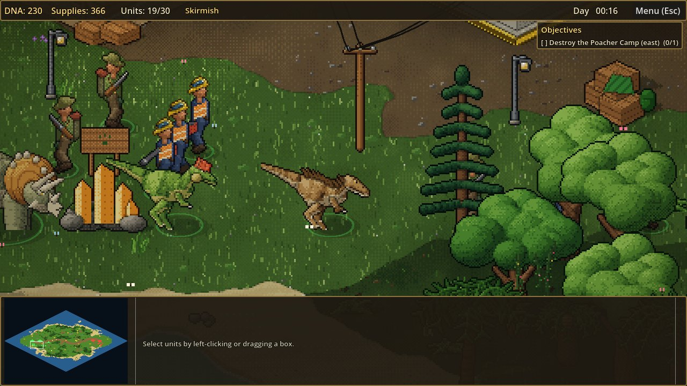

## What it is

DinoTrouble is a real-time strategy game set on a dinosaur reserve. A poacher company has landed on your jungle island. Your engineers gather DNA from amber deposits and supplies from caches. You hatch raptors, dilophosaurs, triceratops and a T. rex, build watchtowers, and send everything east to wipe out the poacher camp.

There's a five-mission campaign, from a tutorial to a night raid on a poacher outpost to the final assault on Poacher HQ. There's also a skirmish mode on a random island.

**[Play it in your browser](https://thatadamroberts.github.io/DinoTrouble/)**, or press Play above to play it right here. It needs a mouse and keyboard, and full screen helps. There's also a Windows build in each run of the repo's GitHub Actions.

## Why I built it

<!-- TODO: Write this in your own words. Which late-90s dinosaur RTS did you grow up with, and what did you want to recreate? -->

## Dinosaurs that don't just follow orders

Each dinosaur plays differently:
- **Raptors** are fast, cheap pack hunters.
- **Dilophosaurs** spit venom that slows.
- **Triceratops** charge and knock enemies back.
- **The T. rex**'s roar makes humans flee.

Dinosaurs also get hungry. They need to feed near a Hatchery, and a starving one goes feral: it ignores your orders and heads off to eat. Without a Hatchery it escapes into the jungle. Engineers can tame wild dinosaurs too, though predators have to be wounded below half health first.

The poachers fight back with rifle-armed hunters, trappers whose nets stun dinosaurs, and fast jeeps. They run their own economy and send growing waves at your Hatchery.

## Night on the island

A full day lasts about six minutes. At night the island darkens: windows, lamps, campfires and jeep headlights glow, fireflies come out, and every unit's sight drops by up to 25%. That changes how you scout and when you attack.

## Every sprite and sound made by code

There isn't a hand-drawn pixel in the game. A small Python renderer builds each dinosaur, human and jeep from simple 3D shapes, lights them from one sun in the upper left, then reduces them to hand-picked colour ramps with ordered dithering. That's what gives them the late-90s shaded pixel-art look. Each unit has 13 animation frames (idle, walk, attack and death), seen from two angles. The game mirrors them for the other directions.

The ground is one shader that blends grass, jungle floor, dirt, sand and rock with dithered edges, and animates the water's depth bands, waves and shore foam. Other shaders add drifting cloud shadows and foliage swaying in the wind.

The audio is synthesised too: rifles, a call for each species, a T. rex roar, tribal-drum music that crossfades to a combat track when fighting starts nearby, and jungle ambience that changes with the time of day. Because none of it is recorded, a checking script looks for clipping, silence, loop seams and variations that sound too alike.

## Tested by playing itself

Under the hood it's Godot 4.3 and about 6,500 lines of GDScript. Units find their way around with A* pathfinding on the island grid, and a fog of war tracks what you've explored and what you can see right now.

Every push runs a headless smoke test. It starts a match with a fixed seed, then moves, gathers, hatches, builds, fights, tames and starves units, lets the poacher AI play for a few minutes, and checks the victory condition. CI then renders the game on a software GPU and saves screenshots, which catches broken shaders. The screenshots on this page come from that step. After that it exports the Windows and web builds and publishes the web one to GitHub Pages.

## Built with Claude Code

<!-- TODO: The commit history shows the game was built in Claude Code sessions in a single day (5 November). Say as much or as little as you like, or delete this section. -->

## What's next

<!-- TODO: Plans? For example, more campaign missions, new dinosaurs, multiplayer, or an itch.io release (the web build already works there). -->
